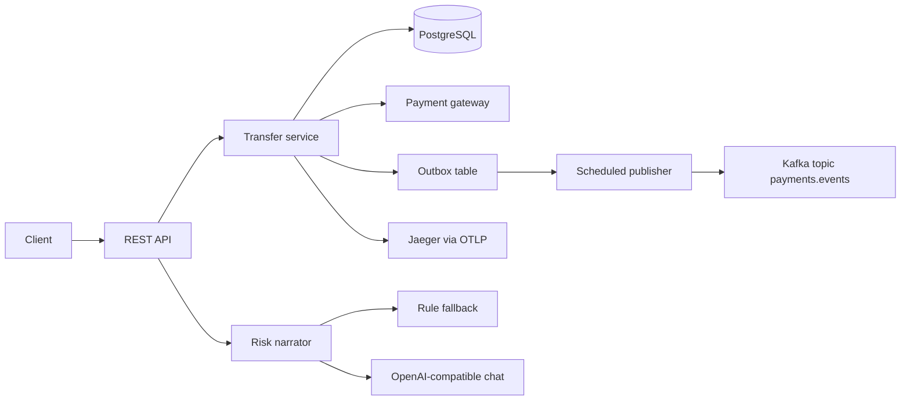

# Ledger Payments Service

A double-entry payments ledger for a fintech core. Every accepted transfer posts a debit and a credit, account balances stay reconcilable to the journal, and the same payment request cannot be charged twice. Risk rules flag unusual activity, and a small AI endpoint explains those flags in plain English when an API key is configured.

## Architecture



The transfer, the journal lines, and the outbox rows commit in one database transaction. A scheduler then publishes those rows to Kafka. The gateway is called through Resilience4j before any balance is changed.

## Tech stack

- Java 21, Spring Boot 3.5, Maven Wrapper
- PostgreSQL 16 and Flyway
- Kafka through Spring Kafka (Boot auto-configuration) and a transactional outbox
- Resilience4j retry and circuit breaker
- Spring AI 1.1 with an OpenAI-compatible chat API, plus a rule-based fallback
- OpenTelemetry traces exported to Jaeger
- springdoc OpenAPI, Actuator health and Prometheus metrics, structured JSON logs
- JUnit 5, AssertJ, Testcontainers
- Docker Compose and GitHub Actions

## Key features

- Customer accounts with an opening journal credit, so the ledger balances from the first row.
- Transfers stored as money with `BigDecimal` scale 2. There is no `double` on the money path.
- Idempotency keys. The same key and body return the original response. The same key with a different body returns 409.
- Optimistic locking on account balances, with the retry outside the database transaction.
- Kafka events `PaymentCreated`, `PaymentCompleted`, and `PaymentFailed`, written through an outbox.
- A simulated gateway with retry and a circuit breaker. `FORCE_DECLINE` and `FORCE_TRANSIENT` in the reference exercise both paths.
- Rule flags for an unusual amount, transfer velocity, and a new beneficiary.
- `GET /api/transactions/{id}/risk-explanation` explains those flags. Without an API key the explanation is built from the rules.

## Run locally

Dependencies only, then the app on the host:

```bash
docker compose up -d postgres kafka jaeger
./mvnw spring-boot:run
```

On PowerShell use `.\mvnw.cmd spring-boot:run`.

Everything, including the packaged app:

```bash
docker compose up --build
```

- API: http://localhost:8080
- Swagger UI: http://localhost:8080/swagger-ui.html
- Health: http://localhost:8080/actuator/health
- Jaeger: http://localhost:16686

The Compose file publishes Kafka on `localhost:9092` for a host process. The app container uses `kafka:19092`. Postgres is `ledger` / `ledger` on the local database `ledger`. Those values are development defaults, not production secrets. Copy `.env.example` if you want to point the app at something else. Do not commit a `.env` file.

To turn the AI narrator on, set both of these and restart:

```bash
export SPRING_AI_MODEL_CHAT=openai
export OPENAI_API_KEY=sk-...
export OPENAI_BASE_URL=https://api.openai.com
export OPENAI_MODEL=gpt-4o-mini
```

`OPENAI_BASE_URL` can be any OpenAI-compatible server. Leave the variables unset and the app still starts. Tests and CI do not need a key.

## API examples

Open two accounts:

```bash
curl -s -X POST http://localhost:8080/api/accounts \
  -H 'Content-Type: application/json' \
  -d '{"ownerName":"Asha","currency":"INR","initialBalance":1000.00}'
```

```json
{
  "id": "6f1c2a0e-1b2d-4a55-9c1e-0b5a2f6d9a10",
  "ownerName": "Asha",
  "currency": "INR",
  "balance": 1000.00,
  "status": "ACTIVE",
  "createdAt": "2026-11-18T08:30:00Z"
}
```

Move money. Repeat the call with the same key and body and the balance does not move again.

```bash
curl -s -X POST http://localhost:8080/api/transfers \
  -H 'Content-Type: application/json' \
  -H 'Idempotency-Key: rent-2026-11-01' \
  -d '{
    "fromAccountId": "6f1c2a0e-1b2d-4a55-9c1e-0b5a2f6d9a10",
    "toAccountId": "b7a1e6c4-88d2-4f0a-9e11-22c4d5e6f708",
    "amount": 25.50,
    "currency": "INR",
    "reference": "rent"
  }'
```

```json
{
  "id": "9c0e1f22-77ab-4d33-8a10-123456789abc",
  "fromAccountId": "6f1c2a0e-1b2d-4a55-9c1e-0b5a2f6d9a10",
  "toAccountId": "b7a1e6c4-88d2-4f0a-9e11-22c4d5e6f708",
  "amount": 25.50,
  "currency": "INR",
  "status": "COMPLETED",
  "riskFlags": ["NEW_BENEFICIARY"],
  "gatewayAuthId": "sim-rent-2026-11-01",
  "createdAt": "2026-11-18T08:31:00Z"
}
```

A transfer the source cannot afford:

```json
{
  "type": "https://ledger.sahidanwar.dev/problems/insufficient-funds",
  "title": "Insufficient funds",
  "status": 422,
  "detail": "The source account does not have enough available balance.",
  "instance": "/api/transfers"
}
```

Explain the flags:

```bash
curl -s http://localhost:8080/api/transactions/9c0e1f22-77ab-4d33-8a10-123456789abc/risk-explanation
```

```json
{
  "transactionId": "9c0e1f22-77ab-4d33-8a10-123456789abc",
  "riskFlags": ["NEW_BENEFICIARY"],
  "explanation": "This transaction was flagged because the beneficiary has not received a completed transfer from this account before.",
  "source": "fallback"
}
```

`source` is `openai` when the chat model answered, and `rules` when nothing was flagged.

Check the books:

```bash
curl -s http://localhost:8080/api/ledger/reconciliation
```

```json
{ "balanced": true, "issues": [] }
```

A reference of `FORCE_DECLINE` records a failed transfer and emits `PaymentFailed` without moving money. `FORCE_TRANSIENT` makes the gateway time out three times, then the circuit-breaker fallback records the same kind of failure.

## Design decisions

Money is a `BigDecimal` with scale 2, checked in the API and again before it is stored. Integer minor units are a good alternative. Scale 2 matches the currencies this service is aimed at and keeps the SQL readable. `double` is rejected because binary fractions cannot represent 0.10.

The account row holds the available balance so a transfer can reject an overdraft without summing the journal. The journal is still the source of truth. Opening an account posts a credit, a completed transfer posts one debit and one credit of the same amount, and a failed transfer posts nothing. `GET /api/ledger/reconciliation` checks those invariants.

Optimistic locking (`@Version`) is used instead of `SELECT FOR UPDATE`. The retry loop lives outside the transaction, because a failed version check has already rolled the transaction back. Accounts are not locked in a fixed order, so this does not deadlock. The concurrency test starts ten transfers of 30.00 against a balance of 100.00 and expects exactly three to succeed.

The idempotency row is inserted in the same transaction as the transfer. A second request with the same key either replays the stored status and body or, if it arrives while the first transaction is still open, fails the unique key and then reads the committed response. Business rejections such as insufficient funds are stored too, so a retry does not become a success just because the balance changed later. Send a new key for a new attempt.

Kafka is not enlisted in the database transaction. The outbox makes the publish durable, and the publisher is at-least-once. A crash after the broker ack and before `published_at` is set sends the event again. Consumers should treat `eventId` as a deduplication key. XA would couple the ledger commit to Kafka availability, which is the failure mode the outbox exists to avoid.

The gateway is simulated so the project runs without a card processor. Resilience4j still wraps it the way a remote client would be wrapped: three attempts for a transient error, then a fallback that records `PaymentFailed`. Declines are normal results and are not retried. The authorization id is derived from the idempotency key so a ledger retry asks for the same authorization.

Risk flags do not block the payment. They are stored on the transfer for review. The narrator prefers the chat model and falls back to a sentence built from the same flags, including when the model call throws. CI never calls a real model.

Traces go to Jaeger over OTLP. Logs are JSON (Spring Boot's logstash structured format) and include the trace id once a request is sampled.

## Testing

```bash
./mvnw verify
```

Unit tests cover the risk rules, the fallback explanation, and the idempotency hash. `LedgerIntegrationTest` starts PostgreSQL and Kafka with Testcontainers and checks:

- a transfer, its replay, and an idempotency conflict
- insufficient funds as a Problem Detail, including the replay
- gateway decline and the three transient attempts
- unusual-amount and velocity flags, and the fallback explanation
- ten concurrent debits that cannot overdraw the account
- outbox rows reaching Kafka as `PaymentCreated`, `PaymentCompleted`, or `PaymentFailed`
- a full reconciliation with an empty issue list

GitHub Actions runs the same `./mvnw verify` on Ubuntu with Java 21. Docker is already available on the runner, which is what Testcontainers needs.

## Possible improvements

- Hold high-risk transfers for review instead of completing them immediately.
- Add a currency exponent table so scale 2 is not assumed for every currency.
- Move the outbox publisher to a separate process and add a dead-letter topic for records that fail repeatedly.
- Replace the simulated gateway with a real acquirer and void the authorization if the ledger commit loses the optimistic lock.
- Partition `payments.events` by account once volume justifies it. One partition is enough to keep a transfer's events ordered today.
